# NYC Taxi Lakehouse


**A daily revenue number a finance analyst can trust, and the engineering story of how I got there.**

This repository is not only code. It records how I approach a data project: start from the people and the decisions they make, agree what is in and out of scope, look at the data before designing, choose tools by writing down the trade-offs, build in thin slices, and prove every number reconciles. The code is the last chapter, not the first.

> **About the "client".** The data is public (NYC TLC Green Taxi trips), so there is no real stakeholder. I played both roles: I wrote down the questions I would ask a finance team and an operations team, answered them as honestly as I could, and treated the result as a binding brief. Where I made an assumption a real client would have to confirm, I say so.

## The result in numbers

| | |
|---|---|
| Raw rows loaded (Jan to Mar 2025) | **146,486** |
| Clean trips in Silver | **145,968** |
| Rejected rows in quarantine, each with a reason | **518** |
| Gold: one row per day | **94 days** |
| Automated checks (4 models + 12 tests) | **16, all passing on both DuckDB and Databricks** |
| Same row counts on both engines | Yes: 145,968 / 518 / 94 |

Nothing is lost on the way: `Bronze rows = Silver rows + rejected rows`, and the Gold total equals the Silver total. Both are enforced by tests, not by hope.

---

## Chapter 1. Understand the problem before touching a tool

I started with people, not technology.

| Who | What they need to decide | What they need from the data |
|---|---|---|
| Finance analyst | "What was revenue yesterday and this month?" | One correct, reconciled daily number with a clear definition |
| Operations manager | "How is demand trending?" | Trip counts per day, trustworthy trends |
| Data engineer (maintainer) | "Is the pipeline healthy? Can I rerun it safely?" | Alerts, lineage, idempotent reruns |

Questions I asked, and why:

- *What is wrong or late data worth?* A wrong revenue number does more damage than a late one, because people act on it and then stop trusting the report. So correctness beats speed.
- *What does "trusted" mean?* Every number can be traced to a source file and reconciled to the source total.
- *How is this done today?* Ad-hoc scripts: slow, hard to reproduce, no way to tell whether a number is right. That is the pain the project removes.

Full brief: [docs/00-product](docs/00-product/).

## Chapter 2. Scope: what I will and will not do

**Goals:** a trusted daily revenue dataset; every number traceable and verifiable; reruns safe; run the platform the way a production team would.

**Non-goals (decided on purpose):** real-time streaming (daily batch is enough for daily revenue), other taxi types in v1 (the design must allow them later), machine learning or forecasting.

**Success metrics I committed to before building:** Gold reconciles to the source 100% (enforced by a test); a rerun gives identical output; every Silver and Gold model has tests; the whole environment can be rebuilt from code.

## Chapter 3. Look at the data before designing

I profiled the three raw files before deciding anything. What I found, and what I decided:

| Finding | Decision | Why |
|---|---|---|
| 478 trips have negative amounts | Keep them as **adjustments**; report gross, adjustments and net separately | Dropping them would hide refunds and make the total wrong. *(Assumption: they are refunds or disputes. A real finance team must confirm.)* |
| 73 trips fall outside their file's month | Keep them, grouped by their **own pickup date** | Moving them would invent dates. Cost: a few partial edge days (for example 2024-12-25 has 1 trip). |
| Card tips are recorded, cash tips are not | **Revenue = `total_amount` − `tip_amount`** | Including tips makes card and cash trips incomparable. |
| 7,385 Silver rows have the descriptive fields (rate code, passenger count, payment type, store-and-forward flag) all empty | **Keep and flag** (`fields_missing`) | They are real trips with real revenue (about $207K). Dropping them would understate revenue. |
| `ehail_fee` is empty in every row | Ignore downstream | No information. |
| 518 trips end before they start (210 in Feb, 308 in Mar, none in Jan) | **Quarantine** with the reason `DROPOFF_BEFORE_PICKUP` | Impossible trips must not reach revenue, but must stay visible. |
| 0 duplicate trips found | Keep the duplicate rule anyway | It costs nothing and protects future months. |

One more thing the data told me: the share of rows with missing descriptive fields **grows every month** (3.8% in Jan, 5.4% in Feb, 6.9% in Mar). That is worth a monitor in a real deployment. I recorded it rather than ignoring it.

## Chapter 4. Define the numbers

A dashboard is only as good as its definitions, so I wrote them down:

| Term | Definition |
|---|---|
| Service date | The calendar date of the pickup time |
| Revenue | `total_amount` minus `tip_amount` |
| Gross revenue | Revenue of trips that are not adjustments |
| Adjustments | Revenue of trips with a negative total (kept, reported separately) |
| Net revenue | Gross plus adjustments |
| Valid trip | Has a pickup, a dropoff, an amount, ends after it starts, and is not a duplicate |

Across the three months: **$3,027,332 gross, −$6,439 adjustments, $3,020,893 net** (rounded to whole dollars).

## Chapter 5. Design: architecture and trade-offs

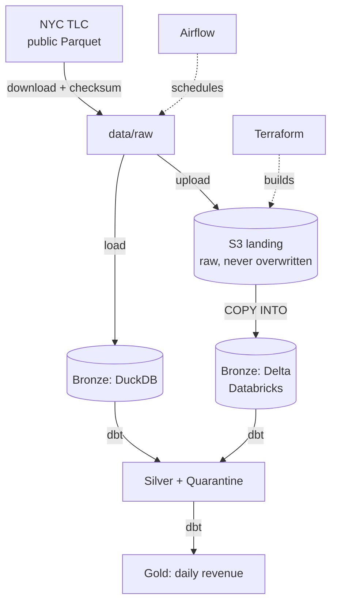

**Layers.** Landing keeps the original files untouched. Bronze is an exact table copy plus three trace columns. Silver is typed, deduplicated and flagged, with a quarantine table for rejects. Gold is the business aggregate. Raw data is never edited, so any mistake in Silver or Gold can be fixed by rebuilding from Bronze.

**Technology choices.** Each tool had to win a written comparison. I did not pick tools because they were popular.

| Decision | Chosen | Instead of | Why | Record |
|---|---|---|---|---|
| Data approach | ELT, medallion layers | ETL in pandas (my original solution) | Raw data stays queryable; SQL logic is testable | [ADR-0002](docs/02-adr/0002-elt-medallion-lakehouse.md) |
| Transformations | dbt | Notebooks, Delta Live Tables | Tests, lineage and docs come with the models | [ADR-0004](docs/02-adr/0004-dbt-for-transformations.md) |
| Orchestration | Airflow | Prefect, Databricks Workflows, MWAA | Industry standard; MWAA is too costly for a showcase | [ADR-0005](docs/02-adr/0005-airflow-orchestration.md) |
| Infrastructure | Terraform | Console clicks, CloudFormation | Rebuildable and destroyable. AWS access is time-limited. | [ADR-0006](docs/02-adr/0006-terraform-iac.md) |
| Raw storage | S3, immutable landing | Load straight into the lakehouse | An independent, auditable copy | [ADR-0007](docs/02-adr/0007-s3-landing-zone.md) |
| Compute | Databricks Free Edition | Paid workspace, open-source Spark | No cost; limits were unknown, so I tested them | [ADR-0003](docs/02-adr/0003-databricks-free-edition-first.md) |
| Build approach | Local first (DuckDB, Docker, uv), then cloud | Build straight on AWS and Databricks | Prove the design for free; change one thing at a time | [ADR-0008](docs/02-adr/0008-local-first-duckdb-docker-uv.md) |

The full map from each requirement to the tool that meets it, and the reason for the build order, is in the [decision journey](docs/01-architecture/decision-journey.md).

## Chapter 6. Build in thin slices, local first

I did not build everything at once. Each step proved one idea before the next began:

1. **Download**, safe to rerun: skip files that exist, write to a temporary name, then rename.
2. **Bronze in DuckDB**: prove the data model on a laptop before spending any cloud time. Reloading a file deletes its old rows first, so reruns never duplicate.
3. **dbt Silver and Gold with tests**: staging labels every row, Silver keeps valid rows, quarantine keeps rejected ones, Gold sums per day.
4. **Airflow** wraps the same commands (download, load, build). It adds a schedule, retries and a UI, and the pipeline works without it.
5. **CI**: GitHub Actions runs the tests and the whole dbt build on a clean machine for every push.
6. **AWS with Terraform**: an S3 bucket (private, versioned, encrypted) and an upload step that never overwrites.
7. **Databricks spike**: tested what Free Edition allows instead of assuming, then built the real path (below).
8. **dbt on Databricks**: the same models, a second target in `profiles.yml`.

What these steps look like (click an image to enlarge):

<table>
<tr>
<td><a href="docs/images/airflow/01-dags-list-with-tag.png">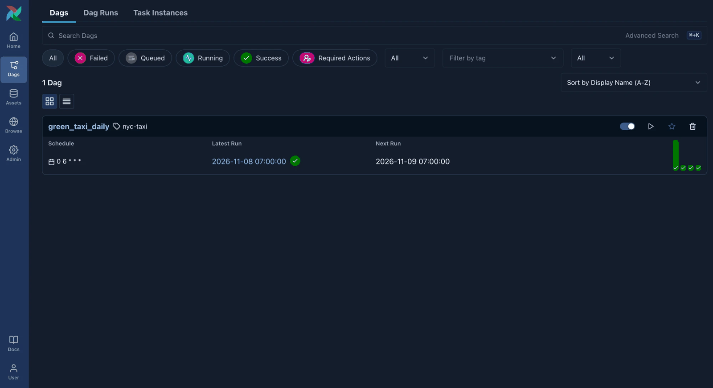</a><br><sub><b>Airflow:</b> the DAG, its tag, its schedule and its run history</sub></td>
<td><a href="docs/images/airflow/04-graph-and-task-log.png">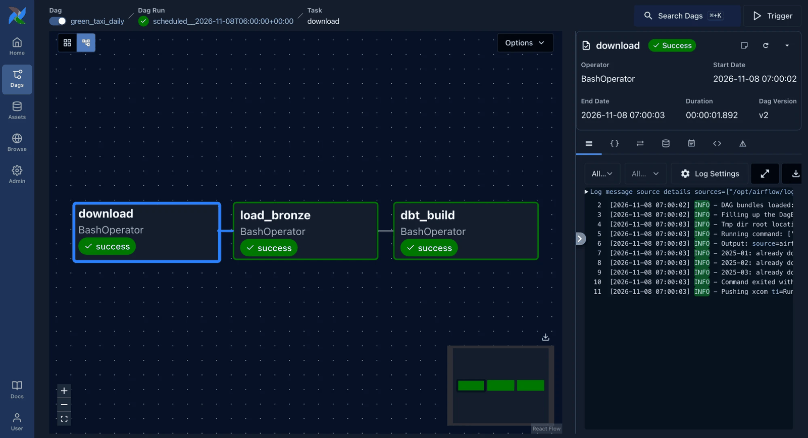</a><br><sub><b>Airflow:</b> download, then load_bronze, then dbt_build</sub></td>
</tr>
<tr>
<td><a href="docs/images/github/01-ci-green-all-steps.png">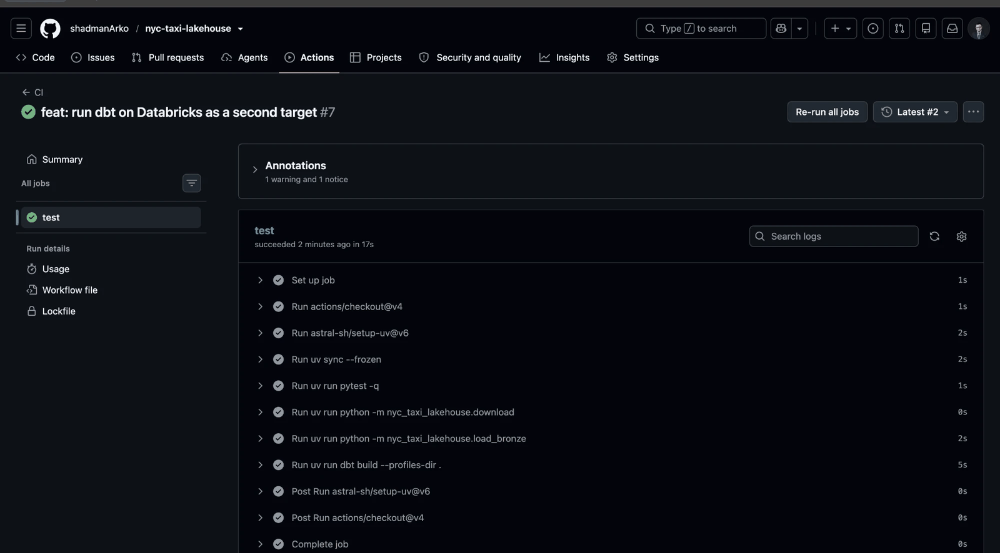</a><br><sub><b>CI:</b> tests, download, Bronze load and dbt build on a clean machine</sub></td>
<td><a href="docs/images/aws/01-s3-partitioned-folders.png">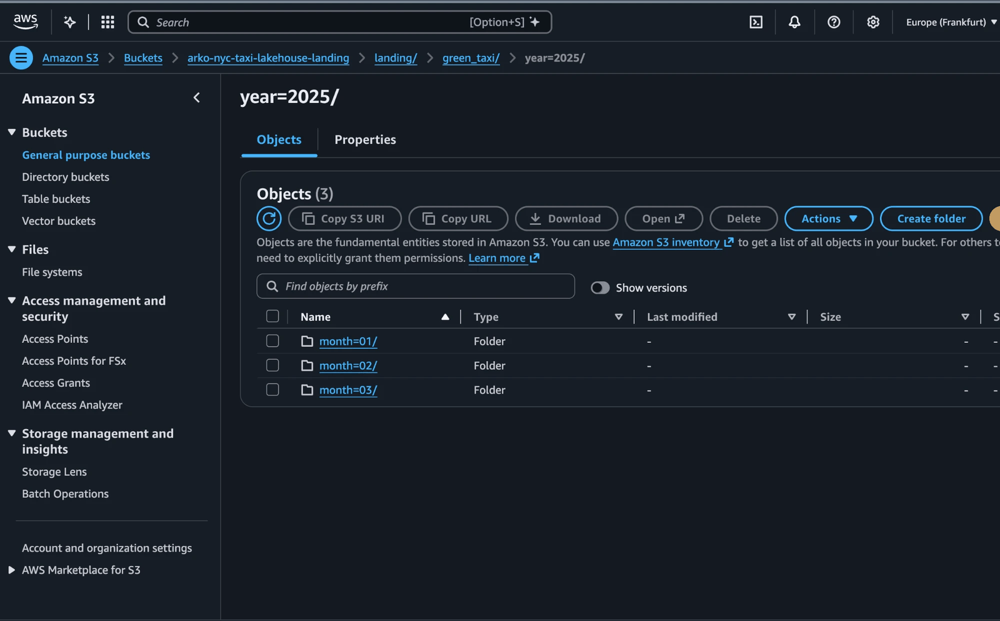</a><br><sub><b>S3 landing zone:</b> raw files in <code>year=/month=</code> folders</sub></td>
</tr>
</table>

**The Databricks path.** Free Edition's documentation did not say whether it can read your own S3 bucket, and community answers disagreed. So I ran a spike, wrote the result into ADR-0003, and built what worked: an IAM role (defined in Terraform) that Databricks may assume, read-only, protected by an external ID, so no AWS keys live in Databricks. Bronze is loaded with `COPY INTO`, which skips files it already loaded.

<table>
<tr>
<td><a href="docs/images/aws/06-iam-trust-policy.png">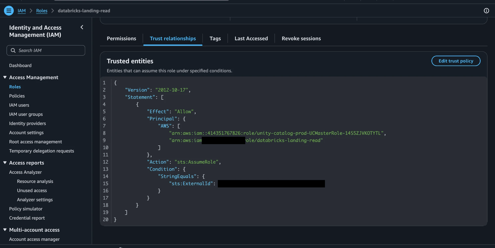</a><br><sub><b>IAM trust policy:</b> only Databricks's role, only with the right external ID (identifiers hidden)</sub></td>
<td><a href="docs/images/aws/07-iam-permissions-read-only.png">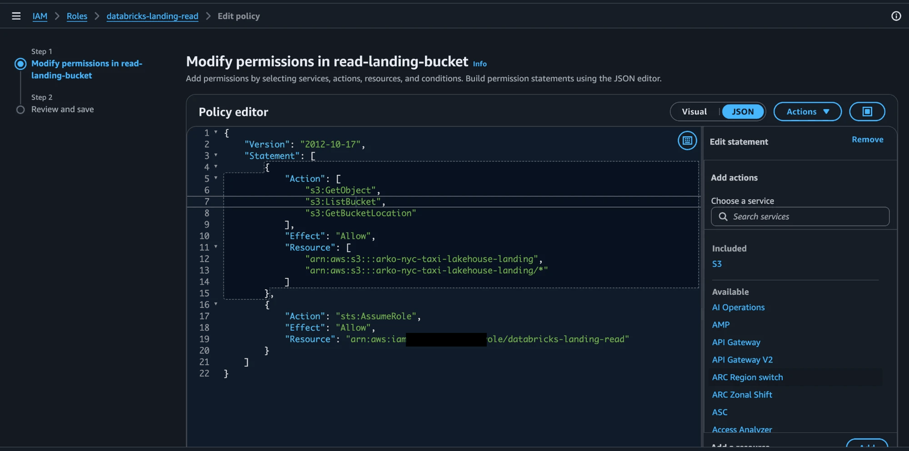</a><br><sub><b>IAM permissions:</b> read-only, one bucket</sub></td>
</tr>
<tr>
<td><a href="docs/images/databricks/05-credential-validated.png">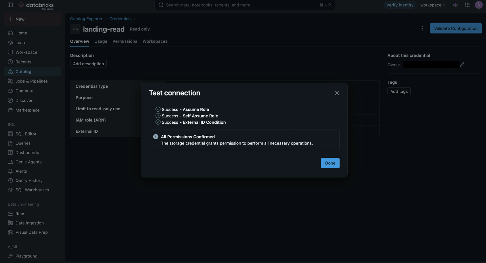</a><br><sub><b>Databricks:</b> the credential passes Assume Role, Self Assume Role and External ID checks</sub></td>
<td><a href="docs/images/databricks/01-catalog-layers.png">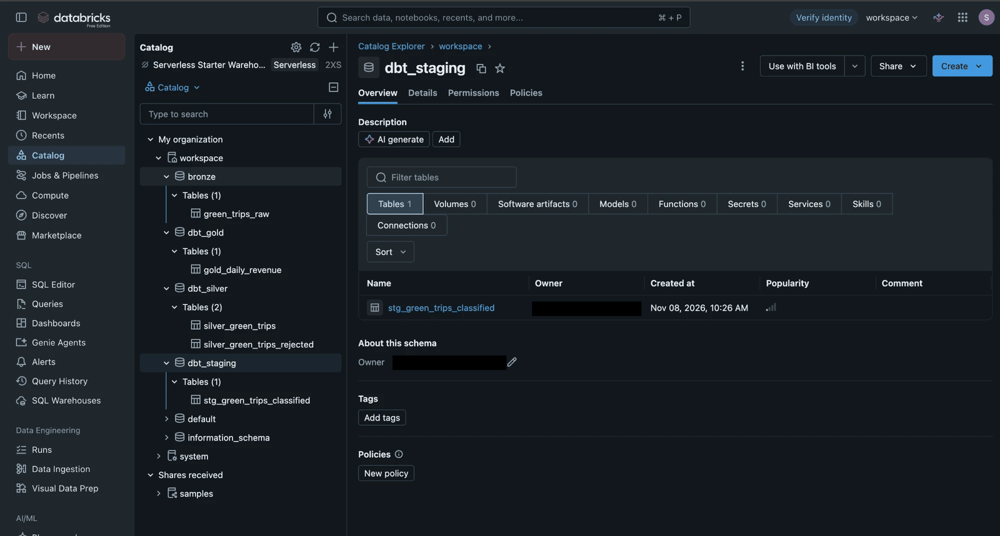</a><br><sub><b>Databricks catalog:</b> every layer as a table</sub></td>
</tr>
</table>

## Chapter 7. Prove it is correct

- **Reconciliation tests.** `Bronze = Silver + rejected`, and `Gold total = Silver total`. If rows vanish or sums drift, the build fails.
- **Schema tests.** Unique and not-null keys, and an allowed list of reject reasons.
- **Cross-engine check.** The same raw files gave the same counts in DuckDB and Databricks.
- **Idempotency check.** Running the load twice changes nothing (0 rows affected on the second `COPY INTO`).

Locally, `dbt build` ends with the same line as on Databricks and in Airflow:

```
Done. PASS=16 WARN=0 ERROR=0 SKIP=0 NO-OP=0 REUSED=0 TOTAL=16
```

<table>
<tr>
<td><a href="docs/images/databricks/07-sql-row-counts.png">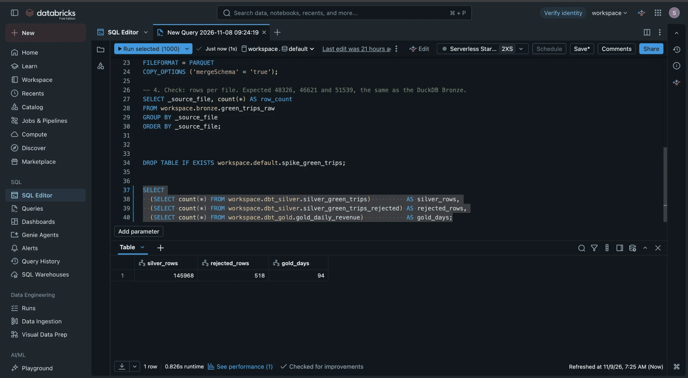</a><br><sub><b>Databricks:</b> 145,968 Silver, 518 rejected, 94 Gold days, the same as DuckDB</sub></td>
<td><a href="docs/images/databricks/08-copy-into-second-run-zero.png">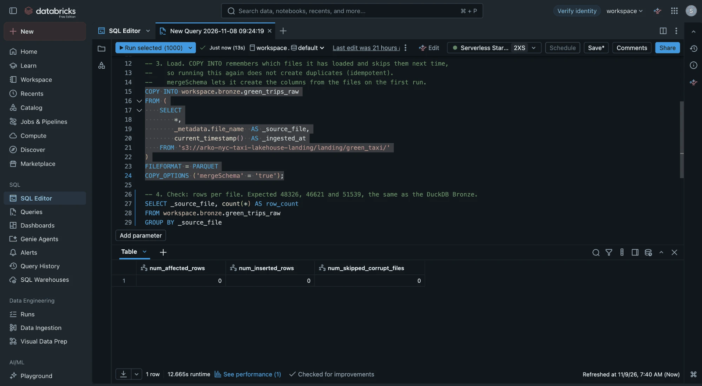</a><br><sub><b>Idempotency:</b> the second <code>COPY INTO</code> loads 0 rows</sub></td>
</tr>
<tr>
<td><a href="docs/images/airflow/06-dbt-build-log-pass-16.png">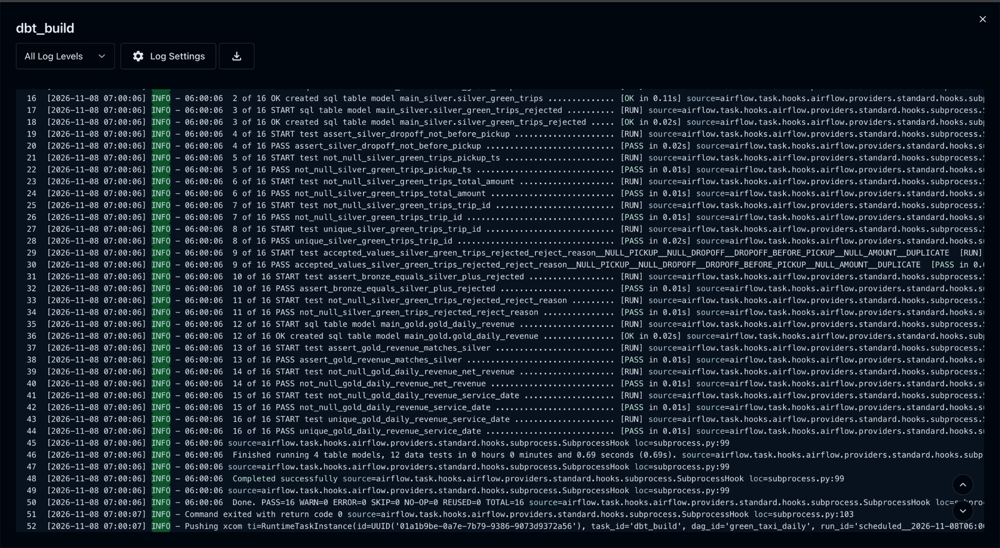</a><br><sub><b>Airflow:</b> the dbt tests run inside the scheduled job</sub></td>
<td><a href="docs/images/databricks/04-gold-lineage.png">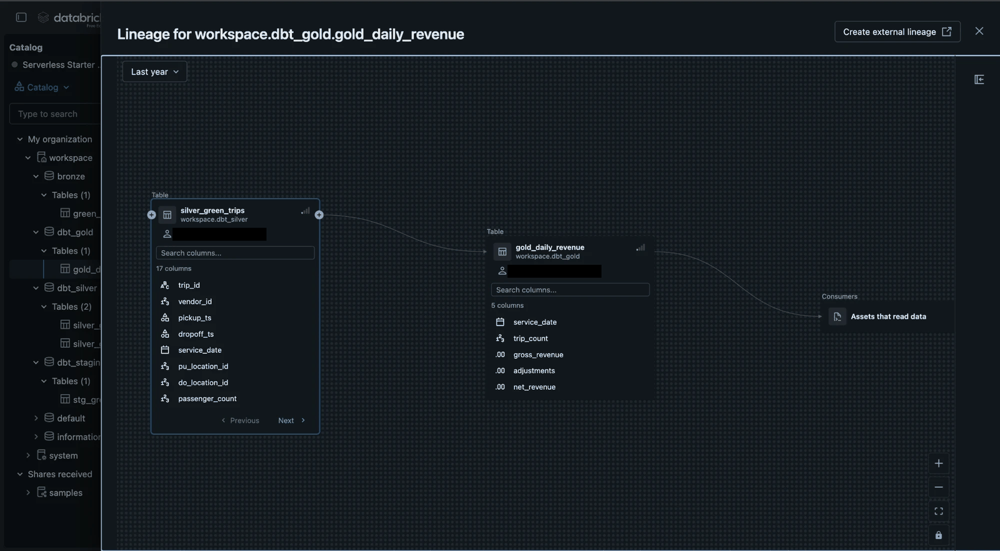</a><br><sub><b>Lineage:</b> Silver feeds Gold, drawn by Databricks</sub></td>
</tr>
<tr>
<td colspan="2"><a href="docs/images/databricks/03-gold-sample-data.png">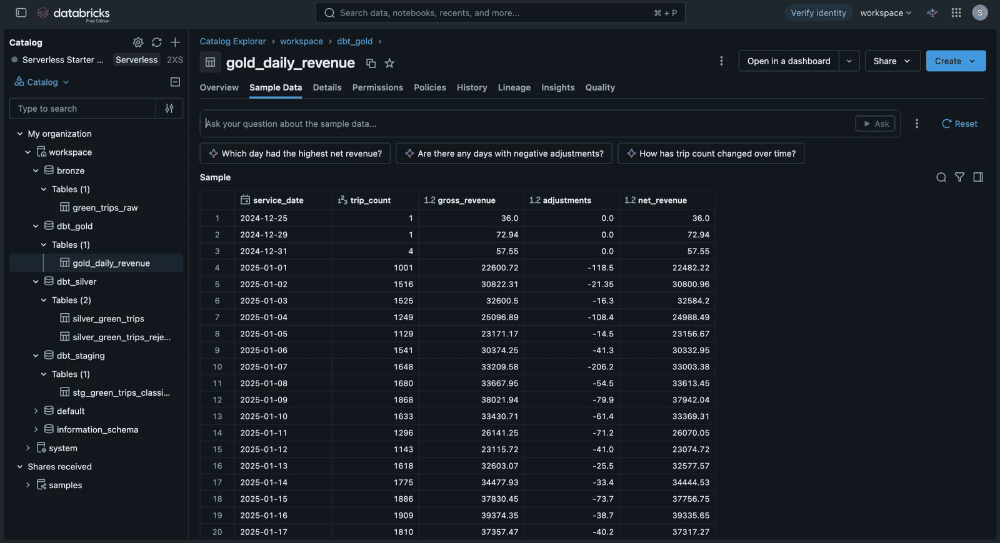</a><br><sub><b>The result:</b> one row per day, with gross, adjustments and net revenue</sub></td>
</tr>
</table>

## Chapter 8. What went wrong, and what I learned

| What happened | What I learned |
|---|---|
| I removed the "dropoff before pickup" rule to test my tests, and the build **still passed**, because the reconciliation held anyway | A test must check the *output rule*, not just the totals. I added `assert_silver_dropoff_not_before_pickup`, and it now fails with 518 rows if the rule disappears. |
| A manual and a scheduled Airflow run overlapped, and DuckDB locked (it allows one writer) | `max_active_runs=1`. Concurrency limits belong in the design, not in the postmortem. |
| The Databricks load failed: `timestampNtz` | Delta needs a table feature switched on for these timestamps. I set it in the table and the dbt config. |
| `varchar` casts are not portable | Use `string`, which works in both engines. |
| CI once failed with a 504 while downloading a tool | I read the log first. It was a GitHub outage, not our code, so a re-run was the right answer. |

The Airflow incident, in the tool's own words:

<table>
<tr>
<td><a href="docs/images/airflow/07-failed-first-try-duckdb-lock.png">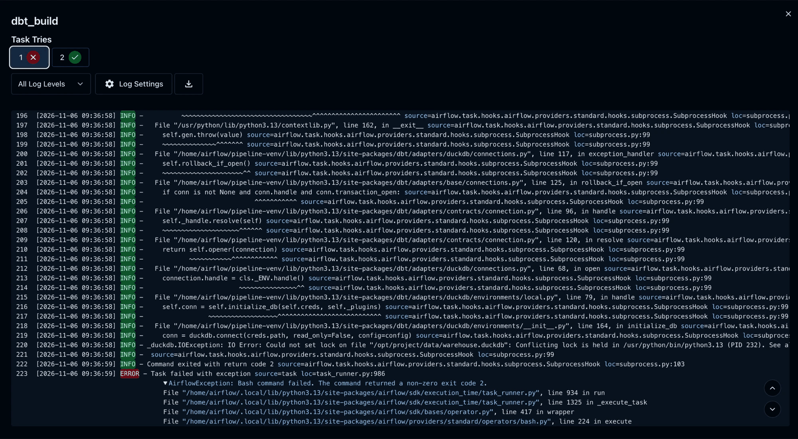</a><br><sub><b>Try 1 failed, try 2 passed:</b> <code>Could not set lock on file ... warehouse.duckdb</code></sub></td>
<td><a href="docs/images/airflow/03-task-instances-with-retry.png">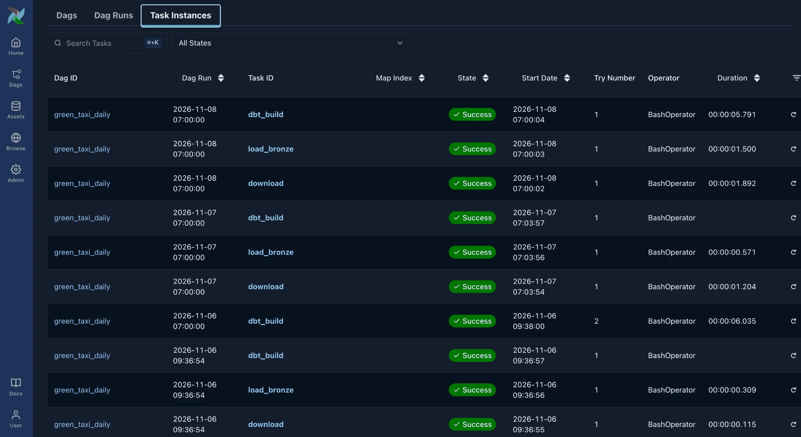</a><br><sub><b>The retry</b> (Try Number 2) is what saved that run</sub></td>
</tr>
<tr>
<td colspan="2"><a href="docs/images/airflow/02-dag-runs.png">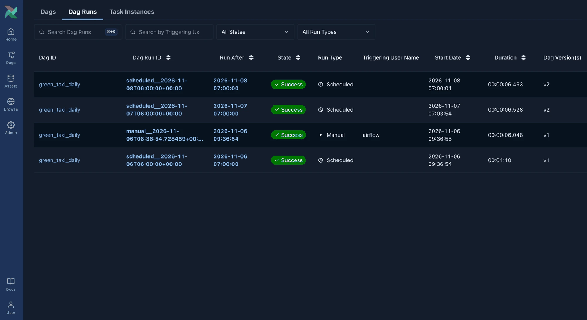</a><br><sub><b>The cause:</b> a manual and a scheduled run overlapped. After the fix (<code>max_active_runs=1</code>) the DAG version moved from v1 to v2.</sub></td>
</tr>
</table>

## Design versus delivered (the honest scorecard)

I wrote requirements first. Here is where reality landed:

| Requirement | Status |
|---|---|
| Idempotent ingestion (FR-2) | **Done** (download, upload, Bronze load) |
| Bronze keeps raw rows plus load metadata (FR-3) | **Done** (DuckDB has all three columns; Databricks has source file and load time) |
| Silver dedups and quarantines with a reason (FR-4) | **Done.** Types come from the Parquet schema; I did not add explicit casts. |
| Gold daily revenue (FR-5) | **Done, with different columns than planned:** gross, adjustments and net instead of `total_revenue` and `avg_fare` |
| Tests gate promotion (NFR-2) | **Done:** `dbt build` skips downstream models when an upstream test fails |
| Reproducible, pinned dependencies (NFR-3) | **Done** (`uv.lock`, CI installs it frozen) |
| Transformations are SQL in dbt (NFR-8) | **Done** |
| Raw files stored with a recorded checksum (FR-1) | **Partial:** the checksum is printed, not stored |
| Rejected rows reported per run (FR-6) | **Partial:** the quarantine table exists, there is no per-run report |
| Failures alert within 5 minutes (NFR-1) | **Partial:** retries work, but the failure callback only prints a message |
| No long-lived credentials (NFR-4) | **Partial:** nothing secret is in git and Databricks uses a role, but my laptop uses an IAM user key. OIDC for CI is not set up. |
| Everything as code (NFR-6) | **Partial:** S3 and IAM are in Terraform, but the Databricks credential and external location were created in the UI |
| Backfill by date range (FR-7) | **Not done:** the months are hard-coded |
| Dashboard (FR-8) | **Not done** |
| Run metrics, cost alert, remote Terraform state (NFR-5, NFR-7) | **Not done** |

Two design choices also changed on contact with reality: dbt models are plain tables rebuilt each run, not incremental merges (ADR-0004 planned merges), and Airflow uses simple shell tasks, not Cosmos.

**Known limits.** Airflow still runs only the local DuckDB pipeline, and its Docker image has not been rebuilt since I added the Databricks adapter. The Databricks Bronze load is a SQL file I run by hand. Databricks sits in US East while the bucket is in Frankfurt, which works but would be a data-residency question for real European data. Free Edition has one small SQL warehouse and a daily quota.

**What I would do next:** Airflow runs the Databricks path with the token as a secret; a dashboard on Gold; real alerts; a per-run reject report; a "complete day" flag for the partial edge days; and aligning the older design documents with what was built (the product brief and data model still show the first definition of revenue).

---

## More evidence

<details>
<summary>AWS, Terraform, Airflow and Databricks screenshots (click to expand)</summary>

| | |
|---|---|
| <a href="docs/images/aws/02-s3-file-in-month-folder.png">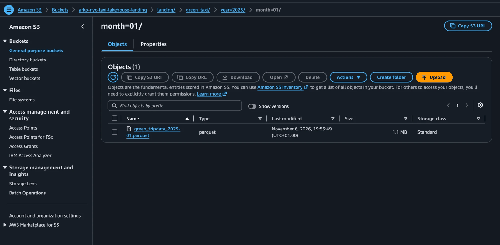</a><br><sub>One raw file, unchanged</sub> | <a href="docs/images/aws/03-s3-versioning-enabled.png">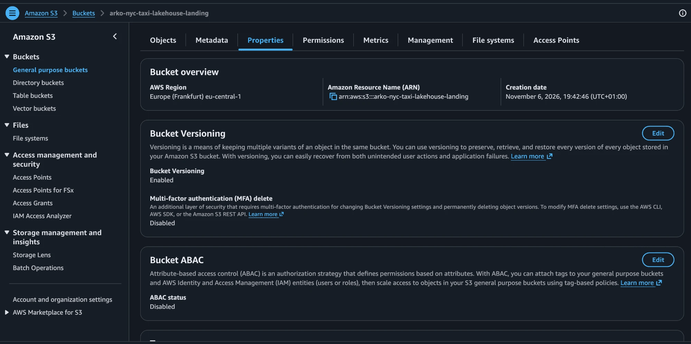</a><br><sub>Versioning enabled</sub> |
| <a href="docs/images/aws/04-s3-default-encryption.png">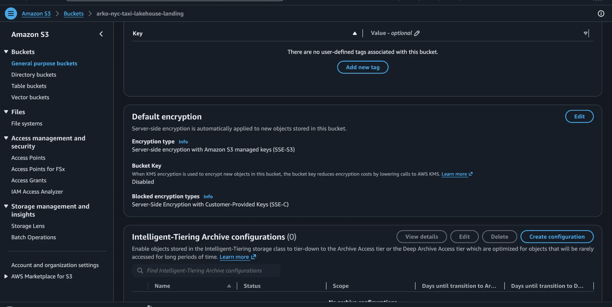</a><br><sub>Encryption at rest (SSE-S3)</sub> | <a href="docs/images/aws/05-s3-block-public-access.png">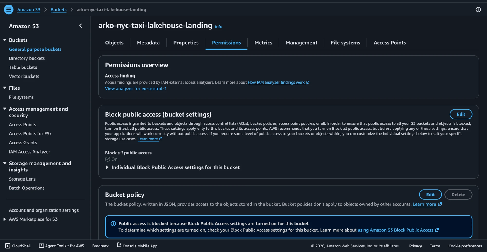</a><br><sub>Block all public access: On</sub> |
| <a href="docs/images/aws/08-terminal-s3-ls.png">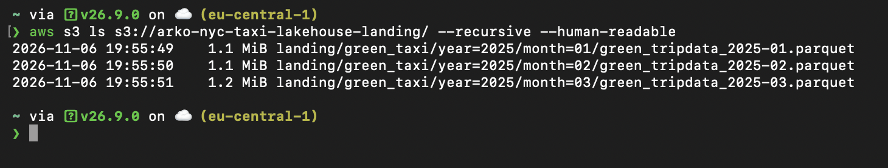</a><br><sub>The same files from the command line</sub> | <a href="docs/images/aws/09-terraform-state-list.png">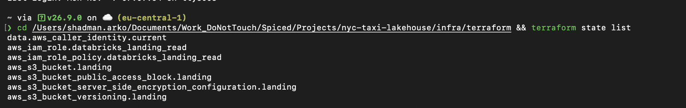</a><br><sub>Everything Terraform manages</sub> |
| <a href="docs/images/aws/10-terraform-no-changes.png">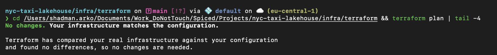</a><br><sub>Code and real infrastructure agree</sub> | <a href="docs/images/airflow/05-run-detail.png">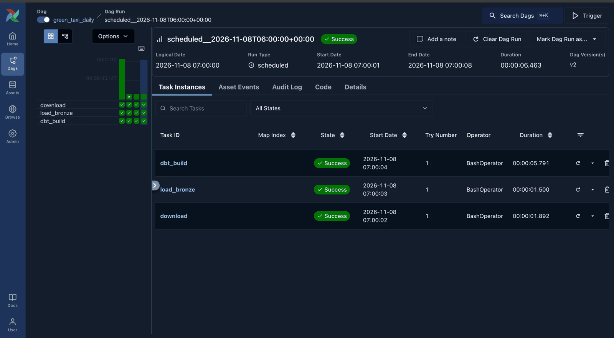</a><br><sub>One full Airflow run</sub> |
| <a href="docs/images/databricks/02-bronze-sample-data.png">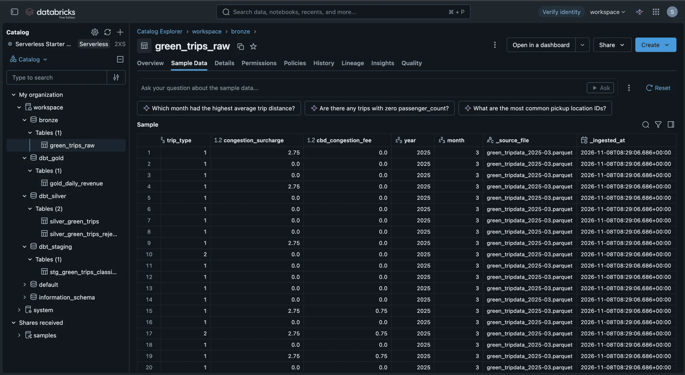</a><br><sub>Bronze rows carry their source file and load time</sub> | <a href="docs/images/databricks/06-external-location.png">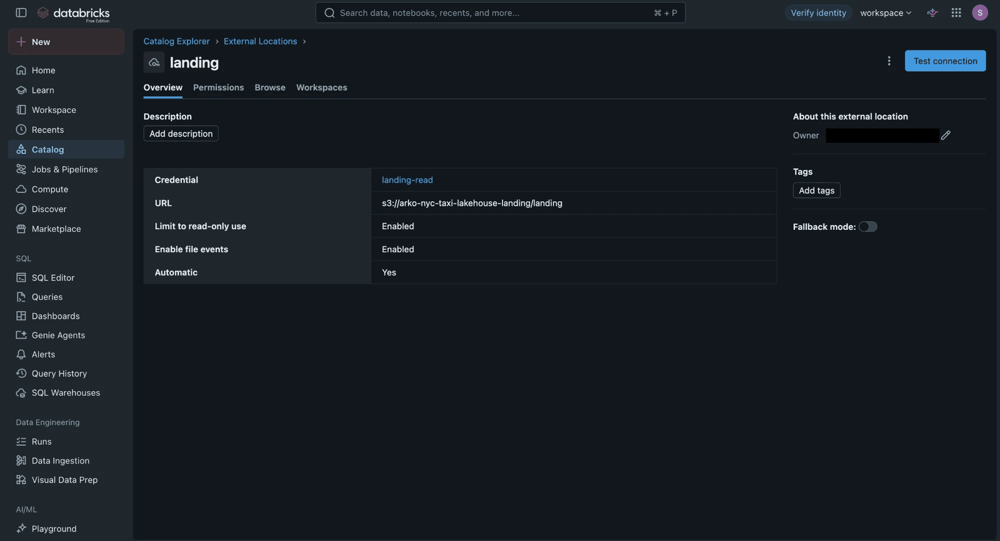</a><br><sub>External location on the S3 landing path, read-only</sub> |
| <a href="docs/images/github/05-actions-all-green.png">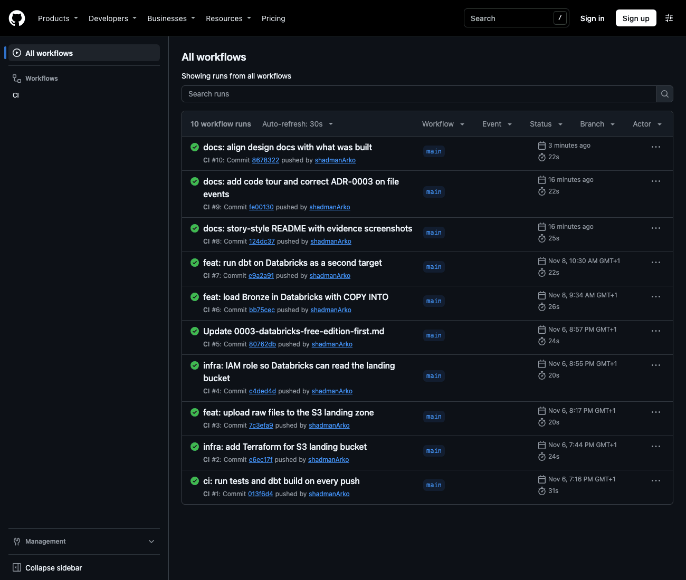</a><br><sub>Ten CI runs, all green (the failed one was re-run)</sub> | <a href="docs/images/github/04-commits.png">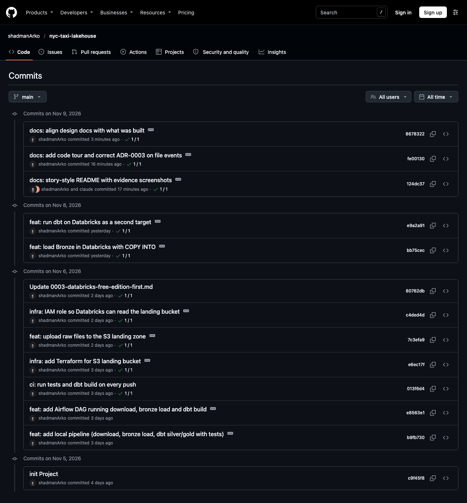</a><br><sub>Small commits with clear messages</sub> |
| <a href="docs/images/github/03-adr-folder.png">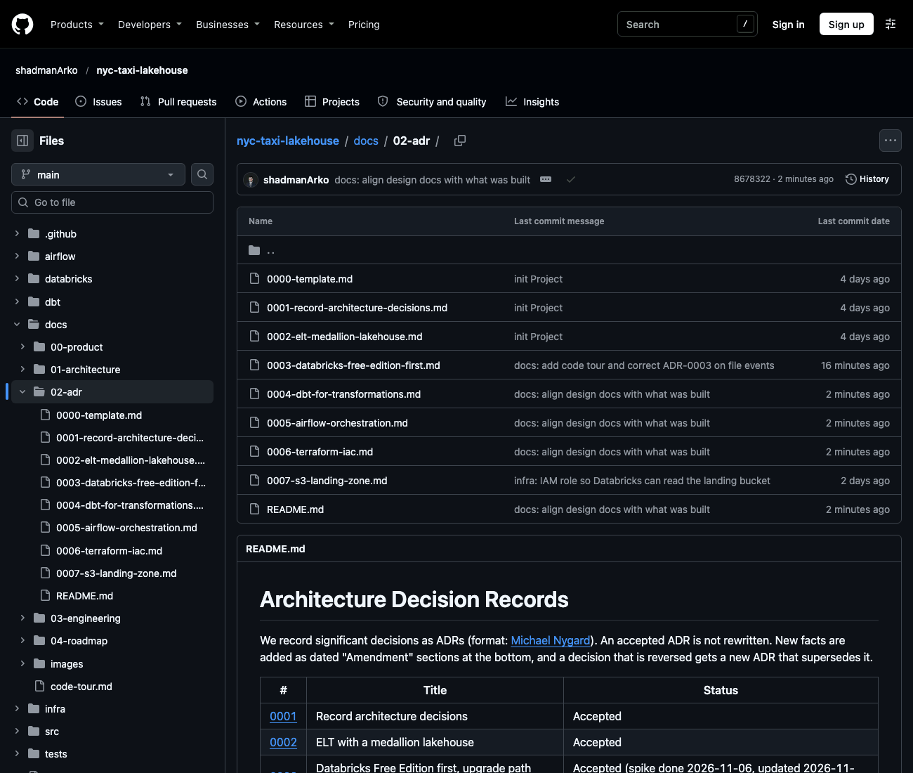</a><br><sub>The decision records and their index</sub> | |

</details>

## Run it yourself

**Local pipeline (DuckDB).** Needs [uv](https://docs.astral.sh/uv/).

```bash
uv sync
uv run pytest
uv run python -m nyc_taxi_lakehouse.download
uv run python -m nyc_taxi_lakehouse.load_bronze
cd dbt && uv run dbt build --profiles-dir .
```

**Airflow in Docker.** Needs Docker.

```bash
docker compose -f airflow/docker-compose.yml up --build
```

Open `http://localhost:8080` and look for the DAG `green_taxi_daily`. There is no login, which is on purpose and for local use only.

**AWS (optional, needs your own account).** Change the bucket name in `infra/terraform/main.tf` and `src/nyc_taxi_lakehouse/upload_landing.py` first, because S3 names are global. Then `terraform init && terraform plan` inside `infra/terraform`. The Databricks role is applied in two phases (see the comments in `iam.tf`).

**Databricks (optional, Free Edition).** Run `databricks/load_bronze.sql` in the SQL Editor, then set `DATABRICKS_HOST`, `DATABRICKS_HTTP_PATH` and `DATABRICKS_TOKEN` in your shell (never in a file) and run `uv run dbt build --target databricks --profiles-dir .` inside `dbt/`.

## Repository map

```
src/nyc_taxi_lakehouse/   download, Bronze load (DuckDB), upload to S3
dbt/                      models (staging, silver, gold), tests, profiles for both engines
airflow/                  DAG and Docker setup
databricks/               Bronze load for Databricks (COPY INTO)
infra/terraform/          S3 bucket and the IAM role for Databricks
.github/workflows/        CI
tests/                    Python unit tests
docs/                     the written-first design: product brief, requirements,
                          architecture, ADRs, engineering standards, roadmap
```

For a guided walk through the key lines of code, with a plain explanation of each, see the [code tour](docs/code-tour.md).

The design documents were written **before** the build. Where the build differed, this README and the ADRs for Databricks (0003) and S3 (0007) hold the current truth.
