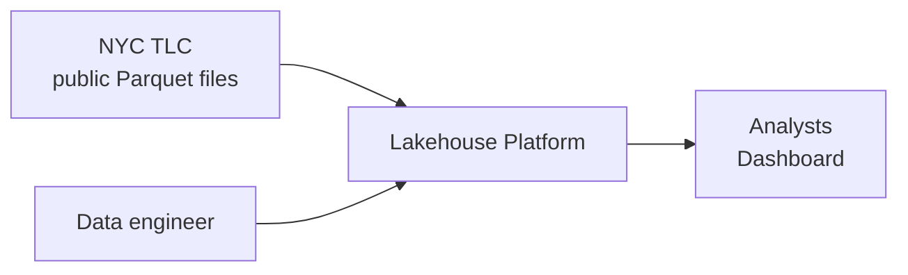
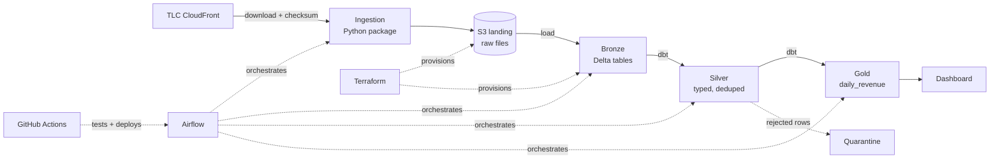

# Architecture Overview

## System context

## Containers and data flow

## Layers

| Layer | Contents | Rules |
|---|---|---|
| Landing (S3) | Original files, unmodified, partitioned `source/dataset/year=/month=/` | Immutable; never overwritten, new versions added |
| Bronze | Raw rows as-is + `_source_file`, `_ingested_at`, `_batch_id` | No business logic; append only |
| Silver | Typed, deduplicated, validated rows; quarantine table for rejects | Explicit schema; every rule tested |
| Gold | Business aggregates (`daily_revenue`) | Documented definitions; contract tests |

## Cross-cutting concerns

- **Orchestration:** one Airflow DAG per dataset, parameterised by month; backfills via date ranges. dbt models render as tasks via Cosmos.
- **Quality:** dbt tests at each layer; reconciliation test ties Gold totals to Bronze totals minus quarantined rows.
- **Environments:** `dev` and `prod` as separate catalogs/schemas and separate S3 prefixes or buckets.
- **Security:** IAM roles with least privilege; GitHub OIDC to AWS; secrets never in git.
- **Observability:** run metadata table (rows in/out/rejected, duration), Airflow failure alerts, dbt/Elementary reports, lineage via dbt docs.

## Free Edition constraint

Databricks Free Edition limits external cloud connectivity and compute. The initial design keeps S3 as the system of record for raw files and loads into Databricks through a supported path (details and fallback in ADR-0003). The boundary is isolated so moving to a full workspace later changes only the load step.

## Open questions

1. Exact supported S3-to-Databricks path on Free Edition (verify against current docs).
2. Where Airflow runs for demos (local Docker vs. a small EC2).
3. Dashboard tool: Databricks AI/BI vs. Superset.
