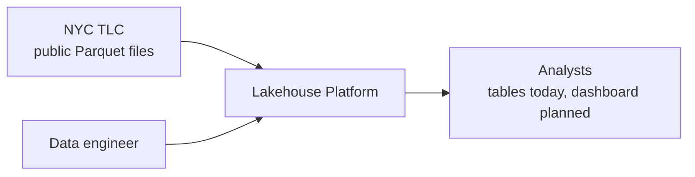
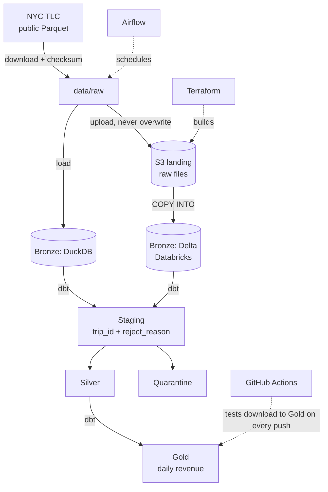

# Architecture Overview

Updated 2026-11-09 to describe what is built. The original plan was broader; where the build differs, the table under "Planned versus built" says so.

## System context

## Containers and data flow

Airflow schedules the local DuckDB path only. Databricks is loaded by running `databricks/load_bronze.sql` and `dbt build --target databricks` by hand.

## Layers

| Layer | Contents | Rules |
|---|---|---|
| Landing (S3) | Original files, unmodified, partitioned `landing/green_taxi/year=/month=/` | Immutable: an existing key is never uploaded again |
| Bronze | Raw rows as-is plus `_source_file`, `_ingested_at` (and `_batch_id` on DuckDB) | No business logic; each file is loaded once, reruns do not duplicate |
| Staging (dbt) | Every Bronze row plus `trip_id`, `copy_number`, `reject_reason` | One row per Bronze row; holds all validity rules in one place |
| Silver | Valid rows with flags (`is_adjustment`, `fields_missing`); quarantine table for rejects with a reason | Two opposite filters over staging, so every row lands in exactly one |
| Gold | `gold_daily_revenue`: gross, adjustments, net per day | Documented definitions; reconciliation tests |

Column-level detail: [data-model.md](data-model.md).

## Planned versus built

| Concern | Planned | Built |
|---|---|---|
| Orchestration | One DAG per dataset, parameterised by month, backfill by date range, Cosmos | One DAG with three shell tasks, retries and `max_active_runs=1`; no Cosmos, no backfill (ADR-0005) |
| Quality | dbt tests, dbt-expectations, Elementary | dbt tests only: 12 (schema and custom reconciliation tests); a failing test blocks the models after it |
| Environments | `dev` and `prod` | `dev` only |
| Security | Least-privilege IAM, GitHub OIDC to AWS, secrets in a manager | Least-privilege read-only role for Databricks; nothing secret in git, tokens from environment variables; no OIDC (ADR-0006) |
| Observability | Run metadata table, alerts, Elementary reports, lineage | dbt and Databricks lineage; Airflow history; the failure callback only prints a message |
| Infrastructure | S3, IAM, OIDC, budgets, remote state | S3 and IAM in Terraform with local state; Databricks credential and location created in the UI |

## What the Databricks Free Edition spike settled

The documentation did not say whether Free Edition can read a customer's own S3 bucket, so it was tested (ADR-0003). It can: through an IAM role, a Unity Catalog storage credential and an external location. A laptop can also run dbt against its SQL warehouse with a personal access token. The S3-to-Bronze load is isolated in one file (`databricks/load_bronze.sql`), so moving to a full workspace would change that step only.

## Open questions

1. Can dbt run from inside the Airflow container against Databricks? Verified from a laptop only; tokens are short-lived and would have to be supplied as a secret.
2. Dashboard tool: Databricks AI/BI or Superset. Not decided and not built.
3. Does Auto Loader work in directory-listing mode without file events? Not tested.
